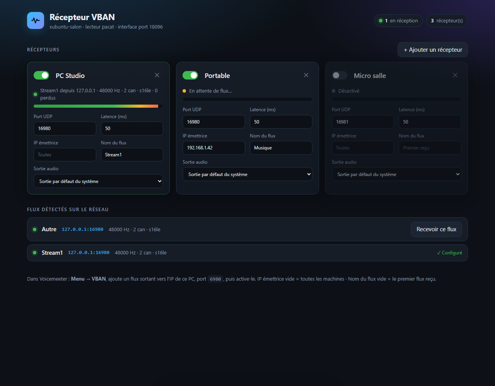

# VBAN Player pour Ubuntu

Recevez sur un PC **Ubuntu / Xubuntu** le son envoyé en **VBAN** par
[Voicemeeter](https://vb-audio.com/Voicemeeter/) (ou tout autre émetteur VBAN),
et réglez tout depuis une page web.



- **Aucune dépendance Python** : un seul fichier, Python 3 standard.
- Fonctionne avec **PulseAudio** et **PipeWire** (Ubuntu 20.04 → 24.04 et plus).
- **Plusieurs récepteurs** en même temps, chacun avec son port, son filtre d'IP,
  son nom de flux et sa sortie audio.
- **Détection automatique** des flux VBAN présents sur le réseau.
- Vumètre, état en direct et compteur de paquets perdus.
- Réglages appliqués sans redémarrer, enregistrés dans `vban_recv.json`.

## Installation

```bash
sudo apt install git python3 pulseaudio-utils
git clone https://github.com/alertencis/VBAN-PLAYER-UBUNTU.git ~/VBAN-PLAYER-UBUNTU
cd ~/VBAN-PLAYER-UBUNTU
python3 vban_recv.py
```

Puis ouvrez **http://localhost:8096** sur le PC, ou **http://IP_DU_PC:8096**
depuis une autre machine du réseau.

> `pulseaudio-utils` fournit `pacat`, déjà installé sur la plupart des Ubuntu.
> Sans lui, le récepteur utilise `aplay` (paquet `alsa-utils`).

## Configurer l'émetteur (Voicemeeter)

1. Dans Voicemeeter : **Menu → VBAN** (ou le bouton *VBAN* en haut à droite).
2. Dans **Outgoing streams**, sur une ligne libre :
   - **Stream Name** : par exemple `Stream1` ;
   - **IP Address To** : l'adresse IP du PC Ubuntu (`hostname -I` pour la connaître) ;
   - **UDP Port** : `6980`.
3. Activez la ligne, puis le bouton **VBAN** général.

Le flux apparaît alors dans **Flux détectés** sur la page : cliquez sur
**Recevoir ce flux**, puis **Appliquer**.

## Utiliser l'interface

Chaque carte est un récepteur :

| Réglage | Rôle |
|---|---|
| Interrupteur | Active ou désactive le récepteur |
| Nom | Nom affiché dans le mixeur du système (`pavucontrol`) |
| Port UDP | Port d'écoute, `6980` par défaut |
| IP émettrice | N'accepte que cette machine ; vide = toutes |
| Nom du flux | N'accepte que ce flux VBAN ; vide = le premier reçu |
| Sortie audio | Carte son / haut-parleurs utilisés |
| Latence | Tampon en millisecondes ; à augmenter si le son craque |

Le voyant indique l'état : **vert** = réception, **orange** = en attente,
**rouge** = erreur (par exemple un port déjà utilisé).

## Lancement automatique

Pour démarrer le récepteur avec la session :

```bash
mkdir -p ~/.config/systemd/user
cp vban-recv.service ~/.config/systemd/user/
systemctl --user daemon-reload
systemctl --user enable --now vban-recv
```

Le fichier suppose que le dépôt est cloné dans `~/VBAN-PLAYER-UBUNTU` ;
sinon, modifiez la ligne `ExecStart`.
Journal : `journalctl --user -u vban-recv -f`.

## Options

```
python3 vban_recv.py [--web-port 8096] [--web-bind 0.0.0.0] [--backend pacat|aplay]
```

- `--web-bind 127.0.0.1` : interface accessible uniquement depuis le PC lui-même.
- `--backend aplay` : jouer directement via ALSA, sans PulseAudio / PipeWire.

## Pare-feu

Si `ufw` est actif :

```bash
sudo ufw allow 6980/udp   # flux VBAN
sudo ufw allow 8096/tcp   # interface web (facultatif)
```

## Dépannage

- **Rien dans « Flux détectés »** : vérifiez l'IP et le port dans Voicemeeter,
  le pare-feu, et que les deux machines sont sur le même réseau.
- **Voyant rouge « Port indisponible »** : un autre programme écoute déjà ce port
  (par exemple le module VBAN de PipeWire). Changez de port ou arrêtez l'autre
  programme : `ss -ulpn | grep 6980` pour le trouver.
- **Son haché** : augmentez la latence (80–150 ms), préférez le câble au Wi-Fi.
- **Pas de son mais voyant vert** : vérifiez la sortie choisie et le volume de
  l'application « VBAN … » dans `pavucontrol`.

## Sécurité

L'interface web n'a pas de mot de passe : toute personne sur le réseau local
peut modifier les réglages. Utilisez-la sur un réseau de confiance, ou lancez-la
avec `--web-bind 127.0.0.1`.

## Licence

[MIT](LICENSE)
